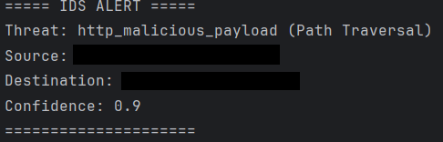

# Python Network IDS


A lightweight network intrusion detection system written in Python. It sniffs live TCP traffic with Scapy, runs signature based rules, and uses an Isolation Forest model to flag statistically unusual traffic.

> **Authorized use only.** Only run this on networks you own or have explicit permission to monitor.

  

## Detections

| Detection | Method | Details |
|---|---|---|
| SYN flood | Signature | 20+ SYN (no ACK) packets to the same destination/port within 2 seconds |
| Port scan | Signature | One source sending SYNs to 15+ distinct well-known ports (<1024, 8000, 8080, 8443) |
| SQL injection | Signature (regex) | Patterns like `UNION SELECT`, `' OR '1'='1` in HTTP payloads |
| Cross-site scripting | Signature (regex) | `<script>`, `javascript:`, `onerror=`, `onload=` |
| Path traversal | Signature (regex) | `../../`, `/etc/passwd`, `win.ini` |
| Network anomaly | ML (Isolation Forest) | Scores log-scaled packet size, packet rate, and byte rate against a learned baseline |

Alerts are printed to the console and written as JSON to `ids_alerts.log`.

## How it works

```
Scapy sniffer thread -> queue -> TrafficAnalyzer -> DetectionEngine -> AlertSystem
                                 (per-flow features)  (signatures + ML)   (console + log)
```

- **Capture:** a background thread sniffs TCP/IP packets and pushes them onto a thread-safe queue.
- **Feature extraction:** per-flow stats use a 5-second sliding window, so a burst isn't diluted by a long-lived flow's history. The flow table is size-capped.
- **Signatures:** SYN and port-scan rules use time-windowed state that expires, so memory stays bounded and a source can be re-alerted after a cooldown. HTTP payloads are matched both raw and URL-decoded, since clients and attackers routinely percent-encode (`%27` for `'`).
- **Anomaly detection:** on first run the model collects 500 samples of traffic, trains an Isolation Forest, and saves it to `anomaly_model.pkl`. Later runs load the saved model.

## Installation

Requirements: Python 3.10+, and a packet capture driver ([Npcap](https://npcap.com) on Windows, libpcap on Linux/macOS). Capturing requires administrator/root privileges.

```bash
git clone https://github.com/Nsomma1/python-network-ids.git
cd python-network-ids
python -m venv .venv
.venv\Scripts\activate          # Windows (use source .venv/bin/activate on Linux/macOS)
pip install -r requirements.txt
```

## Usage

```bash
python ids.py --list-interfaces              # find your adapter
python ids.py --interface "Your Adapter Name"   # run as admin/root
```

## Testing

Unit tests use synthetic packets and need no network access or privileges:

```bash
pytest -v
```

They cover each signature rule (including URL encoded payloads), alert cooldowns, state expiry, sliding window features, bounded memory, and the training pipeline.

### Live testing

The IDS only observes traffic; it doesn't need a server to run. For live tests, though, there are two requirements:

1. **Traffic must come from a different device.** Traffic from a machine to its own IP is usually short-circuited by the OS and never reaches the sniffed interface. Use a second computer, a phone on the same Wi-Fi, or a VM.
2. **HTTP signature tests need a listener.** The attack payload is only sent after the TCP handshake completes, which requires something listening on the target port. On the machine running the IDS, start a throwaway web server in a second terminal:

   ```bash
   python -m http.server 8080 --bind 0.0.0.0
   ```

   On Windows you may also need an inbound firewall rule for that port. The port scan and SYN flood tests do **not** need a listener, since they only look at SYN packets.

Then, with the IDS running (as admin/root), send test requests from the other device:

```
http://<ids-host-ip>:8080/?id=1'%20OR%20'1'='1      # SQL injection
http://<ids-host-ip>:8080/?q=<script>alert(1)</script>   # XSS
http://<ids-host-ip>:8080/../../etc/passwd          # path traversal
```

HTTP signature detection was verified end to end this way, from a phone on the same Wi-Fi network. See also [Testing from a VM](#testing-from-a-vm) below.

### Testing from a VM

Run the IDS on the host, pointed at the virtual adapter (e.g. VMware VMnet8), and generate traffic from a Linux VM:

```bash
nmap -sS -p 1-100 <host-ip>            # port scan
sudo hping3 -S -p 8080 --flood <host-ip>   # SYN flood (only against your own machine)
curl "http://<host-ip>:8080/?id=1'%20OR%20'1'='1"   # SQLi signature (needs the listener above running on the host)
```

## Limitations

Being upfront about what this does *not* do:

- **HTTP only for payload inspection.** Encrypted (HTTPS) traffic can't be inspected without TLS interception.
- **Signatures are evadable.** Regex matching won't catch obfuscated payloads, double encoding, or attacks split across TCP segments (no stream reassembly).
- **Baseline poisoning.** The Isolation Forest trains on whatever traffic is seen during its first 500 samples. If an attack happens during that window, it becomes "normal". Train on known-clean traffic where possible.
- **TCP/IPv4 only.** UDP, ICMP, and IPv6 aren't analyzed.
- **Model file trust.** `anomaly_model.pkl` is loaded with `joblib`, which uses pickle. Never load a model file from an untrusted source, since unpickling can execute arbitrary code. The model is git-ignored for this reason.
- **Detection only.** It alerts but doesn't block traffic.

## Future work

- PCAP replay mode for reproducible testing without live traffic
- UDP/ICMP/IPv6 support and TCP stream reassembly
- Structured alert export (JSON lines / syslog) for SIEM ingestion
- Labeled-data evaluation of the anomaly model (precision/recall)

## License

MIT
